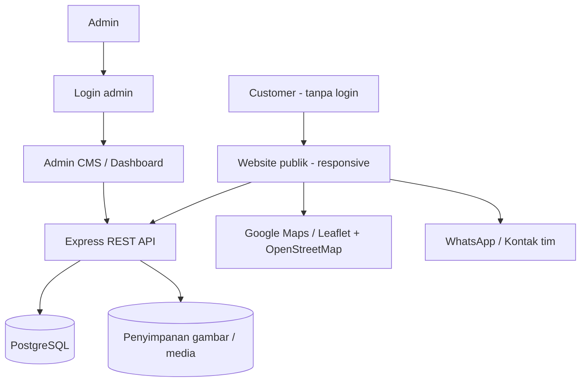
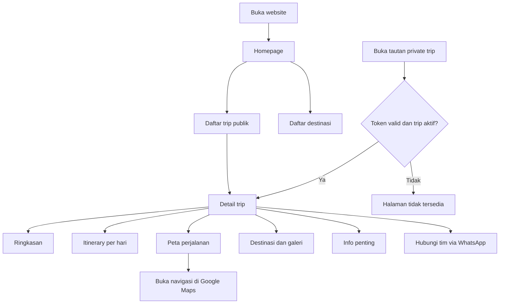
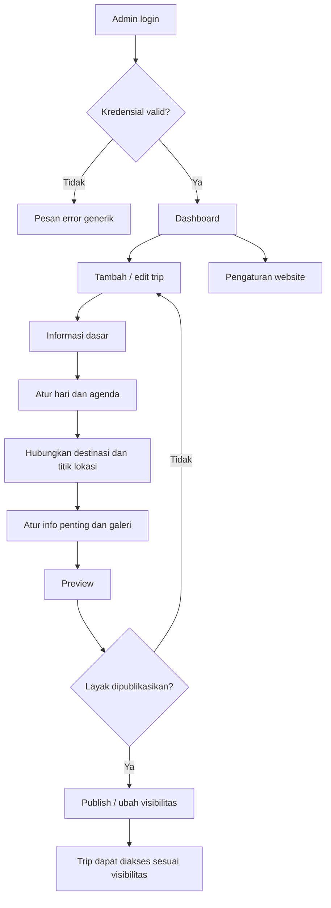
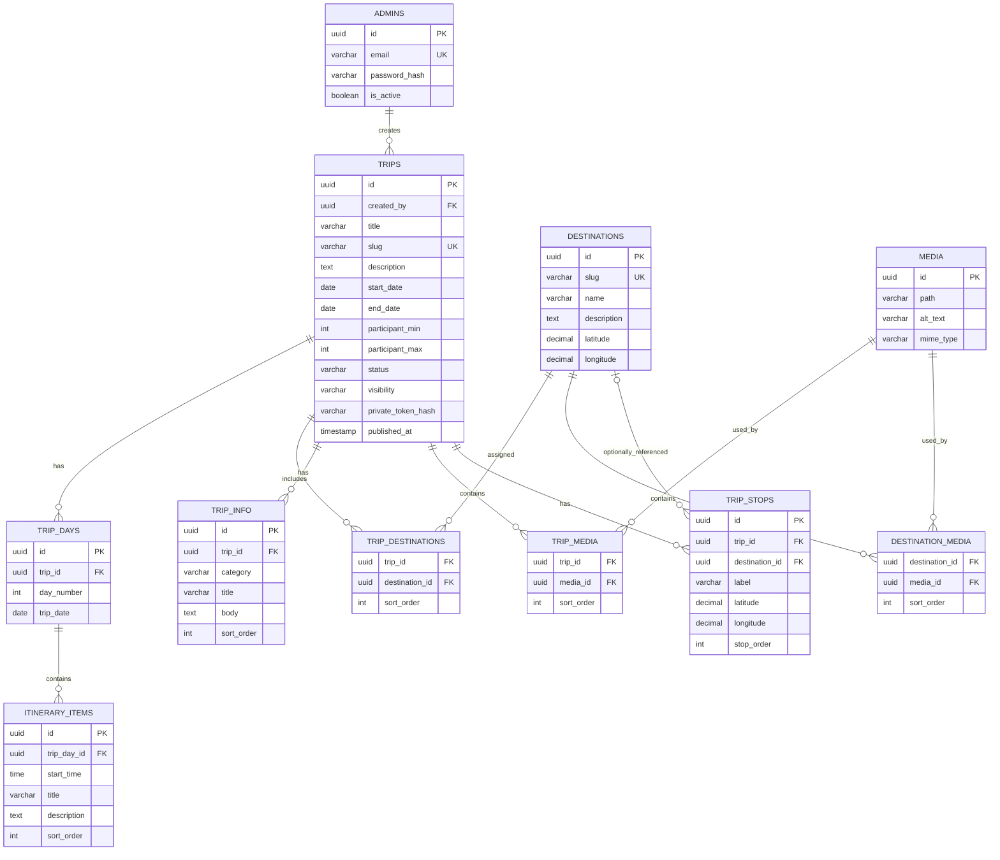

# SYSTEM MAP — PERGI KELUAR

> **Project:** PERGI KELUAR — Trip Information Hub / CMS Trip  
> **Version:** 1.0 (Rancangan awal)  
> **Platform:** Responsive web (mobile-first dan desktop)  
> **Prinsip akses:** Pengunjung/customer **tidak perlu login**; hanya admin yang login untuk mengelola konten.

## 1. Tujuan sistem

Membangun website informasi perjalanan yang dapat dikelola secara dinamis oleh admin tanpa mengubah source code. Customer bisa melihat daftar trip yang dipublikasikan, detail perjalanan, itinerary, peta, destinasi, galeri, dan informasi penting melalui browser.

**Lingkup MVP:** publikasi trip, dashboard dan CMS admin, itinerary per hari, destinasi, rute/lokasi, informasi penting, galeri, pengaturan website, serta preview dan status draft/published. Booking, pembayaran, akun customer, dan absensi digital **belum termasuk MVP**.

## 2. Aktor dan hak akses

| Aktor | Autentikasi | Hak akses |
|---|---|---|
| Visitor/Customer | Tanpa login | Lihat homepage, trip publik, destinasi, itinerary, peta, informasi penting; buka Maps dan hubungi tim |
| Pengguna dengan tautan private trip | Tanpa login | Lihat satu private trip menggunakan token tautan yang valid; tidak muncul di listing publik |
| Admin | Wajib login | CRUD trip, itinerary, destinasi, informasi, galeri, konfigurasi, preview, dan publikasi |

**Catatan keamanan:** Tautan private adalah *akses berbasis kepemilikan tautan* (bukan autentikasi). Hindari menampilkan data pribadi peserta atau informasi sensitif di halaman publik/private berbasis link. PIN atau autentikasi tambahan dapat ditambahkan jika dibutuhkan.

## 3. Peta sistem tingkat tinggi



### Arsitektur aplikasi

- **Frontend publik:** HTML, CSS, Bootstrap 5, dan vanilla JavaScript.
- **Frontend admin:** HTML, CSS, Bootstrap 5, dan vanilla JavaScript.
- **Backend:** Node.js (ESM) + Express REST API.
- **Database:** PostgreSQL, dengan migrasi schema dan indeks.
- **Media:** folder upload lokal pada MVP; bisa ditingkatkan ke object storage.
- **Peta:** Leaflet + OpenStreetMap untuk menampilkan titik; tautan Google Maps untuk navigasi. Jika membutuhkan rute jalan aktual, gunakan routing service yang sesuai, **jangan menggambar garis sebagai rute aktual tanpa data routing**.
- **Deployment:** Debian/Ubuntu, Nginx reverse proxy, HTTPS, process manager (systemd/PM2), backup database dan media.
- **Identitas visual:** oranye sebagai warna aksen, putih/abu-abu sebagai dasar; nilai warna/logo dapat diubah admin melalui Settings.

## 4. User flow — Customer (tanpa login)



**Aturan:** Customer tidak melihat login/register. Trip draft tidak dapat diakses secara publik. Trip private tidak tampil di homepage, pencarian, atau sitemap, dan hanya dapat diakses dengan tautan bertoken yang belum dicabut.

## 5. User flow — Admin



**Fitur pengelolaan:** tambah/edit/hapus arsip, urutkan agenda, upload gambar, status draft/published/archived, pilih public/private, salin tautan private, preview sebelum publish, ubah kontak, logo, dan warna aksen.

## 6. Sitemap dan route frontend

### Publik

| Route | Halaman | Akses |
|---|---|---|
| `/` | Homepage, hero, trip/destinasi pilihan | Publik |
| `/trip` | Daftar trip yang terbit dan bersifat publik | Publik |
| `/trip/:slug` | Detail trip publik | Publik |
| `/t/:token` | Detail trip privat via tautan acak | Pemegang tautan |
| `/destinasi` | Daftar destinasi | Publik |
| `/destinasi/:slug` | Detail destinasi publik | Publik |
| `/tentang` | Tentang penyelenggara | Publik |
| `/404` | Halaman tidak ditemukan | Publik |

### Admin

| Route | Halaman | Akses |
|---|---|---|
| `/admin/login` | Login admin | Publik untuk form login |
| `/admin` | Dashboard ringkasan | Admin |
| `/admin/trips` | Tabel trip, filter dan pencarian | Admin |
| `/admin/trips/create` | Form tambah trip | Admin |
| `/admin/trips/:id/edit` | Editor trip bertab | Admin |
| `/admin/destinations` | CRUD destinasi | Admin |
| `/admin/media` | Kelola galeri/media | Admin |
| `/admin/settings` | Branding, kontak, homepage | Admin |

**Tab editor trip:** Informasi Dasar → Itinerary → Destinasi → Peta → Info Penting → Galeri → Preview & Publish.

## 7. Modul dan fungsi

| Modul | Customer | Admin |
|---|---|---|
| Homepage | Lihat hero, trip dan destinasi pilihan | Edit konten hero, featured items, menu, footer |
| Trip | Lihat detail yang boleh diakses | CRUD, duplikasi, status, visibility, slug |
| Itinerary | Timeline per hari dan jam | Tambah hari/agenda, ubah urutan, deskripsi |
| Destinasi | Detail foto, tips, alamat | CRUD data destinasi dan koordinat |
| Rute & Maps | Lihat titik lokasi dan buka navigasi | Atur urutan stop dan koordinat |
| Info penting | Lihat pengingat, bawaan, aturan, kontak | Tambah/edit kategori dan isi |
| Galeri | Lihat gambar | Upload, urutkan, hapus, alt text |
| Pengaturan | Tampilan otomatis sesuai branding | Logo, warna, WhatsApp, sosial media, SEO |
| Dashboard | — | Statistik konten, trip terbaru, draft |

## 8. Model data (rancangan relasional MVP)



Tambahan tabel: `site_settings` (key/value yang divalidasi atau kolom terstruktur), `admin_sessions` (jika session disimpan di DB), dan `audit_logs` (direkomendasikan untuk pelacakan perubahan).

**Field umum:** setiap entitas konten sebaiknya memiliki `created_at` dan `updated_at`; relasi memakai foreign key, transaksi untuk perubahan berantai, serta constraint untuk status/visibility, tanggal, urutan, dan koordinat.

**Status trip:** `draft`, `published`, `archived`. **Visibilitas:** `public`, `private`. `published + public` muncul di daftar; `published + private` hanya dapat diakses melalui token yang aman. Status `archived` dan `draft` tidak tersedia bagi customer. Token private disimpan sebagai hash; tautan plaintext hanya ditunjukkan saat dibuat/diputar ulang dan dapat diregenerasi.

## 9. Kontrak API (contoh MVP)

### API publik — tanpa autentikasi

```http
GET /api/public/site
GET /api/public/trips
GET /api/public/trips/:slug
GET /api/public/private-trips/:token
GET /api/public/destinations
GET /api/public/destinations/:slug
```

API publik hanya mengembalikan field yang aman dan konten berstatus terbit sesuai visibilitas. Jangan menerima `preview=true` tanpa otorisasi sebagai jalan pintas membaca draft.

### API admin — wajib autentikasi & otorisasi

```http
POST   /api/admin/auth/login
POST   /api/admin/auth/logout
GET    /api/admin/auth/me
GET    /api/admin/dashboard

GET    /api/admin/trips
POST   /api/admin/trips
GET    /api/admin/trips/:id
PATCH  /api/admin/trips/:id
DELETE /api/admin/trips/:id
POST   /api/admin/trips/:id/publish
POST   /api/admin/trips/:id/unpublish
POST   /api/admin/trips/:id/rotate-private-link

GET    /api/admin/trips/:id/days
POST   /api/admin/trips/:id/days
PATCH  /api/admin/itinerary-items/:id
DELETE /api/admin/itinerary-items/:id

GET    /api/admin/destinations
POST   /api/admin/destinations
PATCH  /api/admin/destinations/:id
DELETE /api/admin/destinations/:id

POST   /api/admin/media
DELETE /api/admin/media/:id
GET    /api/admin/settings
PATCH  /api/admin/settings
```

CRUD untuk `trip_stops`, `trip_info`, media associations, urutan agenda, dan homepage sections ditambahkan sesuai modul. Buat validasi input dan otorisasi di **server**, bukan hanya menyembunyikan tombol pada frontend. Pertimbangkan pagination dan filter untuk daftar.

## 10. Alur data dan publikasi

1. Admin masuk melalui `/admin/login`.
2. Admin membuat trip dalam status `draft`.
3. Admin menyimpan data dasar, hari/agenda, destinasi, stop lokasi, informasi dan foto ke database/media storage.
4. Admin membuka **Preview** melalui endpoint berotorisasi; draft tetap tidak terlihat publik.
5. Admin memilih visibilitas `public` atau `private` lalu klik **Publish**.
6. Backend memvalidasi kelengkapan minimum, menyimpan status serta waktu publish secara atomik.
7. Customer dapat melihat trip publik dari daftar; private trip hanya dari link bertoken.
8. Perubahan admin setelah terbit tercermin pada halaman customer setelah cache di-refresh atau di-invalidate.

## 11. Struktur folder yang disarankan

```text
pergi-keluar/
├── backend/
│   ├── src/
│   │   ├── app.js
│   │   ├── server.js
│   │   ├── config/
│   │   ├── routes/
│   │   │   ├── public.routes.js
│   │   │   └── admin.routes.js
│   │   ├── controllers/
│   │   ├── services/
│   │   ├── repositories/
│   │   ├── middleware/
│   │   ├── validators/
│   │   └── utils/
│   ├── migrations/
│   ├── tests/
│   └── package.json
├── frontend/
│   ├── public/
│   │   ├── index.html
│   │   ├── trip/
│   │   ├── destinasi/
│   │   └── assets/
│   └── admin/
│       ├── login.html
│       ├── index.html
│       ├── trips/
│       └── assets/
├── storage/
│   └── uploads/
├── deploy/
│   └── nginx/
├── .env.example
├── README.md
└── system_map.md
```

**Catatan implementasi:** Route dinamis `/trip/:slug` dan `/t/:token` perlu rewrite/server rendering atau routing Express; struktur folder di atas adalah organisasi kode, bukan klaim bahwa folder statis dapat memproses parameter URL dengan sendirinya.

## 12. Keamanan dan kualitas

- Admin password di-hash dengan Argon2id/bcrypt dan login diberi rate limit.
- Utamakan session cookie `HttpOnly`, `Secure`, `SameSite` dengan CSRF protection untuk request mutasi; lakukan regenerasi session setelah login.
- API admin dilindungi middleware autentikasi, cek role, validasi payload, dan audit log.
- Escape teks dinamis untuk mencegah XSS; batasi tipe/ukuran upload dan nama file, verifikasi MIME/content, simpan terpisah dari source code.
- Private link menggunakan token acak berentropi tinggi, dapat dicabut/diputar ulang. Jangan menganggap `noindex` sebagai kontrol keamanan.
- Proteksi database dan media dengan backup rutin, uji restore, dan konfigurasi `.env` di luar version control.
- Aplikasi mobile-first; target aksesibilitas dasar: kontras, keyboard navigation, label form, alt text.
- Tangani empty states, loading, error API, validasi tanggal/jam, dan koordinat tidak valid.

## 13. Tahapan pengembangan

| Fase | Fokus | Hasil |
|---|---|---|
| 1 — Fondasi | Setup project, PostgreSQL, migrasi, admin login, layout responsif | Kerangka frontend/backend berfungsi |
| 2 — CMS Trip | CRUD trip, status/visibilitas, preview, publish | Admin bisa menerbitkan trip |
| 3 — Detail Perjalanan | Itinerary, destinasi, info penting, galeri, foto | Halaman detail lengkap dan dinamis |
| 4 — Peta & Branding | Trip stops, Maps, kontak WhatsApp, Settings | Navigasi dan kustomisasi tampilan |
| 5 — Quality & Deploy | Test, auth review, upload validation, Nginx, SSL, backup | Siap digunakan di server |

## 14. Kriteria penerimaan MVP

- [ ] Customer bisa membuka homepage dan trip publik tanpa login.
- [ ] Tidak ada login/register customer dalam navigasi publik.
- [ ] Admin dapat login/logout secara aman.
- [ ] Admin dapat membuat, mengubah, mengarsipkan, dan menerbitkan trip.
- [ ] Admin dapat mengatur agenda per hari/jam serta urutannya.
- [ ] Admin dapat mengelola destinasi, titik lokasi, foto, dan info penting.
- [ ] Admin bisa mengganti logo, warna aksen, hero, kontak, dan footer.
- [ ] Preview draft hanya tersedia bagi admin berotorisasi.
- [ ] Trip private tidak muncul dalam listing, pencarian publik, atau sitemap.
- [ ] Private trip bisa dibuka tanpa login menggunakan tautan yang valid dan dapat dicabut.
- [ ] UI berfungsi baik pada mobile dan desktop.
- [ ] Peta menampilkan titik yang benar; tombol navigasi membuka Google Maps.
- [ ] Semua endpoint mutasi hanya dapat diakses admin.
- [ ] Backup dan restore database/media telah diuji sebelum production.

## 15. Keputusan yang perlu dikonfirmasi sebelum implementasi

1. **Domain:** gunakan domain khusus/subdomain (misalnya `trip.example.com`) atau dipasang di website utama?
2. **Trip private:** cukup tautan rahasia atau perlu PIN tambahan?
3. **Peta:** titik dan tautan Google Maps saja untuk MVP, atau wajib rute jalan otomatis?
4. **Media:** penyimpanan di server sendiri atau object storage?
5. **Jumlah admin:** satu akun pada MVP atau beberapa admin dengan hak akses berbeda?

> **Kesimpulan:** PERGI KELUAR dirancang sebagai **website publik tanpa akun customer + CMS admin yang terlindungi**. Semua informasi utama dikelola dari dashboard dan tersimpan di database; tampilan customer akan mengikuti data terbaru yang dipublikasikan.
